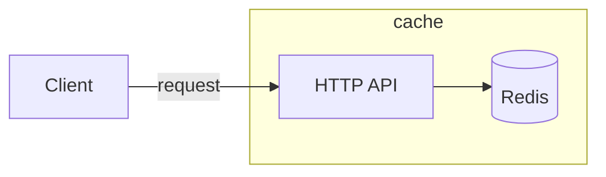

[](https://github.com/eclipse-xfsc/redis-cache-service/-/commits/main)
[](https://github.com/eclipse-xfsc/redis-cache-service/-/commits/main)

# Cache service

Cache service exposes HTTP interface for working with Redis.

It is developed using the [Goa v3](https://goa.design/) framework.

> A helper script named `goagen.sh` can be found inside the root directory of
> the service. It can be used to generate the transport layer code from the
> Goa DSL definitions in the [design](./design) directory. The script should
> be executed everytime the design definitions are updated. It also generates
> updated OpenAPI documentation from the DSL.

Generation: ```
go install goa.design/goa/v3/cmd/goa@v3.20.1
goa gen github.com/eclipse-xfsc/redis-cache-service
```

### Basic Architecture



### Configuration

The cache service is configured using the [Configuration File](./internal/config/config.go).
All configurations are expected as Environment variables specified in the
configuration file. For managing the configuration data from ENV variables,
[envconfig library](https://github.com/kelseyhightower/envconfig) is used.

### API Documentation

[OpenAPI Swagger Documentation](https://github.com/eclipse-xfsc/redis-cache-service/-/blob/main/gen/http/openapi3.json). In the local docker-compose
environment, the Swagger URL is available at http://localhost:8083/swagger-ui.

### Events

The Cache service publishes events to a message broker using the [CloudEvents
specification](https://cloudevents.io/). Current implementation uses [NATS](https://nats.io)
as message broker and uses [cloudevents-go library](https://github.com/cloudevents/sdk-go)
as a client to publish events.

The structure of the `Data` event field is defined in the events [client](./internal/events/client.go). 

### Build

##### Local binary
To make the service binary locally, you can run the following command from the root
directory (you must have [Go](https://go.dev/) installed):
```shell
go build -o task ./cmd/task/...
```

##### Docker image

You can see the Dockerfile of the service under the [deployment](./deployment) directory.
There is one Dockerfile for use during local development with [docker-compose](./deployment/compose/Dockerfile) and one for
building an optimized production image: [deployment/docker/Dockerfile](./deployment/docker/Dockerfile).

### Versioning

There is one global exported variable named `Version` in `main.go`. The variable is set
to the latest tag or commit hash during the build process. You can look in the production
Dockerfile to see how the Version is set during build. The version is printed in the service
log on startup and can be used to verify which specific commit of the code is deployed.

> Version should *not* be set or modified manually in the source code.

### Logging

The service outputs all logs to `stdout` as defined by the best practices in the Cloud Native
community. See here for more details [12 Factor App](https://12factor.net/logs).
From there logs could be processed as needed in the specific running environment.
The standard log levels are `[debug,info,warn,error,fatal`] and `info` is the default level.
If you want to set another log level, use the ENV configuration variable `LOG_LEVEL` to set it.

### Dependencies

There must be a running instance of [Redis](https://redis.io/) visible to the service.
The address, username and password of Redis must be provided as environment variables.

Example:
```
REDIS_ADDR="localhost:6379"
REDIS_USER="user"
REDIS_PASS="pass"
```

### Development

This service uses [Goa framework](https://goa.design/) v3 as a backbone. 
[This](https://goa.design/learn/getting-started/) is a good starting point for learning to use the framework.

### Dependencies and Vendor

The project uses Go modules for managing dependencies, and we commit the `vendor` directory.
When you add/change dependencies, be sure to clean and update the `vendor` directory before
submitting your Merge Request for review.
```shell
go mod tidy
go mod vendor
```

### Tests and Linters

To execute the units tests for the service go to the root project directory and run:
```go
go test -race ./...
```

To run the linters go to the root project directory and run:
```go
golangci-lint run
```

## GDPR

[GDPR](GDPR.md)

## Dependencies

[Dependencies](go.mod)

## Deployment

### Helm

[Helm deployment documentation](deployment/helm/README.md)

## License

[Apache 2.0 license](LICENSE)

## Local development with Docker Compose

This repository includes a root `compose.yaml` with the cache API, Redis 7 and NATS 2.10. From the repository root:

```bash
docker compose up --build -d
docker compose ps
docker compose logs -f cache
curl -i http://localhost:8080/readiness
```

The API listens on `localhost:8080`, Prometheus metrics on `localhost:2112`, Redis on `127.0.0.1:6379`, and NATS on `127.0.0.1:4222`. The development-only Redis password is `localtest`; never reuse it in production. Redis and NATS are ephemeral in this setup. To stop everything use `docker compose down`; add `--volumes` to discard named volumes if added later.

Alternatively, from the repository root, use `docker compose -f deployment/compose/compose.yaml up --build` (requires a Compose implementation supporting `include`). The Docker image builds using vendored Go dependencies. Build errors should be checked against the committed vendor tree and Go toolchain.

### API smoke test

```bash
curl -i http://localhost:8080/readiness
curl -i -X POST http://localhost:8080/v1/cache \
  -H 'Content-Type: application/json' \
  -H 'x-cache-key: example' \
  -H 'x-cache-namespace: demo' \
  -H 'x-cache-scope: local' \
  -d '{"hello":"world"}'
curl -i http://localhost:8080/v1/cache \
  -H 'x-cache-key: example' \
  -H 'x-cache-namespace: demo' \
  -H 'x-cache-scope: local'
```

Consult `gen/http/openapi3.yaml` for exact request schemas and required headers; adjust the example payload if your generated API requires a wrapper. The external-cache endpoint publishes CloudEvents to NATS on `external_cache_events`; it is distinct from a regular cache write. To debug Redis connectivity run `docker compose exec redis redis-cli -a localtest ping`. Check application logs if the service starts but `/readiness` succeeds while Redis is unavailable: the current readiness implementation does not prove dependency readiness.

### Environment variables

| Variable | Purpose | Local Compose value |
| --- | --- | --- |
| `HTTP_HOST`, `HTTP_PORT` | API listener | `0.0.0.0`, `8080` |
| `REDIS_ADDR` | Redis endpoint | `redis:6379` |
| `REDIS_USER`, `REDIS_PASS` | Redis credentials | `default`, `localtest` |
| `REDIS_DB`, `REDIS_EXPIRATION` | Logical DB and default TTL | `0`, `1h` |
| `REDIS_CLUSTER` | Redis cluster mode | `false` |
| `NATS_ADDR`, `NATS_SUBJECT` | NATS server and event subject | `nats:4222`, `external_cache_events` |
| `METRICS_ADDR` | Prometheus listener | `:2112` |
| `AUTH_ENABLED`, `AUTH_JWK_URL` | Optional authentication | disabled by default |

`REDIS_USER` and `REDIS_PASS` are declared required in the Go configuration, including for environments where authentication is not otherwise used. Set them explicitly.

## Kubernetes / Helm deployment

Install without the XFSC injection operator by leaving `podAnnotations` empty and `resourceClaim.redis.enabled: false`. The deployment then supplies `REDIS_ADDR`, `REDIS_USER`, `REDIS_PASS`, and `NATS_ADDR` from values. Application-owned settings (`REDIS_DB`, `REDIS_EXPIRATION`, `REDIS_CLUSTER`, `NATS_SUBJECT`, HTTP and log settings) are always set by Helm.

With a working XFSC injection webhook, configure:

```yaml
podAnnotations:
  inject.xfsc.io/enabled: "true"
  inject.xfsc.io/needs: "redis,nats" # use actual provider names
```

When injection is enabled the chart deliberately omits `REDIS_ADDR`, `REDIS_USER`, `REDIS_PASS` and `NATS_ADDR` from its container environment. The operator must inject **exactly these names**. Confirm the actual names and ResourceProvider replacements for your operator installation before deployment. `envFrom`, `secretEnv` and `extraVars` remain available; avoid duplicate environment names.

### Redis ResourceClaim

An opt-in template `templates/resourceclaim-redis.yaml` has been added. **The uploaded repository does not contain the installed XFSC ResourceClaim CRD or an authoritative Redis provider claim schema**, so the template accepts a configurable `resourceClaim.redis.spec` rather than inventing provider-specific spec fields. Before enabling it, inspect the cluster:

```bash
kubectl api-resources | grep -i resourceclaim
kubectl get crd | grep -i resourceclaim
kubectl explain resourceclaim.spec --recursive
```

Configure the real `apiVersion`, `name` and `spec` from your operator's CRD, for example:

```yaml
resourceClaim:
  apiVersion: <ACTUAL-API-VERSION>
  redis:
    enabled: true
    name: cache-redis
    spec: {} # REPLACE with your installed operator's Redis claim spec
```

The empty `spec` is **not** a deployable Redis claim; it is an intentional placeholder. If the provider creates a Kubernetes Secret, verify that the injected username/password map to `REDIS_USER` and `REDIS_PASS`. Ensure the operator's `inject.xfsc.io/needs` provider identifier matches the created claim/provider configuration.

### Helm checks

```bash
helm lint deployment/helm
helm template cache deployment/helm --namespace cache-test
helm upgrade --install cache deployment/helm --namespace cache-test --create-namespace
kubectl -n cache-test describe deployment cache
kubectl -n cache-test get pods
```

The chart's Service now correctly exposes `.Values.service.port` and forwards to the named `http` container port. The previous template had reversed Service port/targetPort and malformed `envFrom` indentation. The default values reference a private container registry and image pull secret; override both when deploying outside that environment. The existing ingress configuration uses an NGINX rewrite expression with `pathType: Prefix`; validate and adapt it for your ingress controller before exposing externally.

### Limitations and follow-up work

The `/readiness` endpoint is currently application health, not a Redis/NATS dependency check. Production deployments should implement Redis PING and a meaningful NATS connectivity check with timeouts, and decide whether dependency outages should cause readiness failure. The Helm ResourceClaim is a configurable integration point, not a verified operator-specific Redis claim. This change has not been validated against a live Kubernetes cluster or a running Docker daemon in the provided environment.
